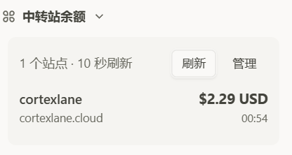
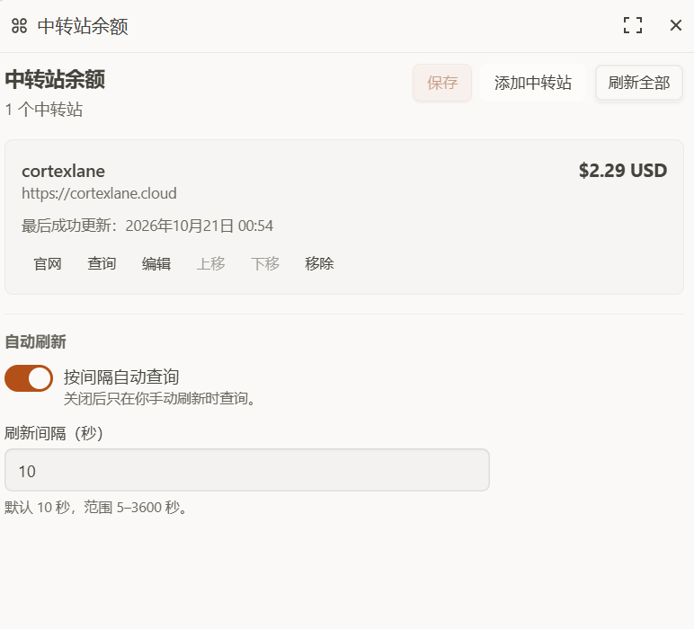

# OpenChamber Custom Provider Usage

在 OpenChamber 的 **Work Status** 中查看多个 **New API** 中转站余额，并在一个面板管理站点。

<p align="center">
  
  <a href="LICENSE"></a>
  
  
</p>

<p align="center">
  <a href="README.md">🇨🇳 简体中文</a> · <a href="README.en.md">🇺🇸 English</a>
</p>

<p align="center">
  <a href="#介绍">介绍</a> · <a href="#安装">安装</a> · <a href="#使用">使用</a> · <a href="#参与开发">参与开发</a> · <a href="#许可证">许可证</a>
</p>

## 目录

- [介绍](#介绍)
- [安装](#安装)
- [使用](#使用)
- [安全与排障](#安全与排障)
- [参与开发](#参与开发)
- [许可证](#许可证)

## 介绍

- 在 Work Status 展示每个站点的余额和最后成功更新时间，可手动刷新或打开管理面板。
- 管理多个站点：添加、编辑、删除、排序，并按站点 New API 配置显示 USD、CNY、自定义币种或原始 quota。
- 配置保存在扩展存储中，更换站点不需要重新构建。

当前仅支持 **New API**，不包含签到、已用额度、请求日志、模型请求代理或历史曲线。余额是站点 quota 的显示值，不代表充值实付或可提现金额。

<table>
  <tr>
    <td align="center" valign="top"><strong>Work Status 区块</strong><br></td>
    <td align="center" valign="top"><strong>中转站管理面板</strong><br></td>
  </tr>
</table>

## 安装

需要 OpenChamber Web 或 Desktop **2.5.0+**。这是最低版本要求，不代表所有后续版本均已验证。VS Code 与移动端不支持此本地服务扩展。

1. 在 OpenChamber 打开 **设置 → 扩展 → 添加**。
2. 选择 Git 仓库地址、项目根目录或维护者提供的 ZIP，然后安装并启用。Git 来源需要宿主环境具备 Git。
3. 安装时阅读并明确批准扩展申请的**本地服务**权限。
4. 从左侧“中转站余额”面板添加站点；再到 **Work Status** 启用并展开“中转站余额”区块。

> GitHub 仓库：[Cicalaqvq/openchamber-custom-provider-usage](https://github.com/Cicalaqvq/openchamber-custom-provider-usage)。克隆地址：
> ```text
> https://github.com/Cicalaqvq/openchamber-custom-provider-usage.git
> ```
> 也可从项目根目录安装；若 OpenChamber 部署在远程服务器，目录安装和本地服务均位于 OpenChamber 宿主侧，而非浏览器所在电脑。目录导入方式取决于宿主提供的功能。

普通用户无需安装 Node.js、npm 或构建工具；宿主提供扩展运行时。通过源码仓库根目录安装时，必须包含预构建的 `dist/extension/`；仅有源码不能直接安装。维护者生成的扩展 ZIP 已包含完整运行文件，解压后选择包含 `package.json` 的文件夹也可安装。

## 使用

### 管理站点

- **地址：**填写站点根地址，例如 `https://relay.example.com`；可省略 `https://`。不得包含路径、查询参数、片段或 URL 内账号密码。公网地址必须使用 HTTPS；HTTP 仅允许本机或内网地址。
- **令牌：**每个站点使用独立的账号 access token / PAT，**不是模型调用用的 `sk-` API Key**。编辑时令牌留空表示保留原值，也可选择清除。
- **保存：**表单里的“完成”只更新当前编辑状态，顶部“保存”才写入设置。
- 可单独查询、刷新全部或调整站点顺序；删除站点需二次确认。“官网”按钮会用系统浏览器打开站点根地址。

### 自动刷新

- 默认开启，间隔 **10 秒**；可关闭或设置为 **5–3600 秒**。
- 仅在 Work Status 区块可见时运行；折叠、页面隐藏或关闭时不发请求。
- 可见区块每 **15 秒**重新读取配置，改动在下一次检查时生效。关闭自动刷新时，新增或修改的站点会立即查询一次，其余站点需手动刷新。

## 安全与排障

> **权限重要提示：**本地服务以当前用户权限运行；SDK 明确说明这不是操作系统级沙箱，具备执行命令及读写文件的能力。不接受此授权模型时，请勿批准或启用扩展。

令牌保存在安装该扩展的 OpenChamber 实例扩展存储中，查询时交给本地服务转发；仅对可信站点使用。

| 现象 | 检查方式 |
| --- | --- |
| 余额为空或返回 401 / 403 | 确认使用账号 access token / PAT（不是 `sk-` API Key），且账号可访问 `/api/user/self`。 |
| 服务未启动或未获授权 | 在**设置 → 扩展**确认扩展已启用并批准本地服务权限；首次请求会启动服务，失败可稍后重试。 |
| 没有站点 | 从左侧“中转站余额”面板添加；Work Status 区块不提供新建表单。 |
| 地址无效或无法连接 | 检查站点根地址和网络；公网须 HTTPS，地址不能带路径、查询参数、片段或账号密码。 |
| 显示原始 quota 与回退说明 | 检查 `/api/status`、`quota_per_unit`、币种类型及相关汇率。 |
| 配置没有立即反映 | 可见区块下一次检查时采用新设置（最长约 15 秒或当前刷新间隔）；折叠时不更新。 |
| 管理面板无法打开 | 区块内“管理”需要当前有项目目录；也可从左侧扩展栏打开“中转站余额”。 |

<details>
<summary>技术行为与限制</summary>

- 余额读取 `GET /api/user/self` 的 `data.quota`，要求 HTTP 2xx、业务成功且 quota 为安全整数；零和负数有效。
- 换算配置读取 `GET /api/status`：USD 为 `quota / quota_per_unit`；CNY 额外乘站点 USD 汇率；CUSTOM 使用站点自定义符号和汇率；TOKENS 显示 quota 原值。配置缺失、无效或币种未知时回退显示原始 quota 并说明原因。
- 每批最多并发查询 4 个站点。失败只更新该站点错误状态，保留上次成功余额和时间，并在区块底部汇总错误。
- 最多 20 个站点；名称最多 40 字符，令牌最多 512 字符。读回存储时会重新校验，损坏条目会被丢弃。
- 当前上游版本无需 `New-Api-User` 用户 ID 请求头；依赖该请求头的旧版或定制版站点可能无法查询。
- 扩展只申请 `service` 权限，不申请 `network`、`files` 或 `filesystem`。OpenChamber 宿主本地服务负责访问动态配置的站点；服务只监听 `127.0.0.1`，每条请求需服务令牌授权，扩展页面通过 `host.serviceRequest` 调用。
- 服务业务接口为 `POST /proxy`，另有宿主就绪检查 `/health`。目标地址会重新校验为 HTTPS 根地址（或本机/内网 HTTP），请求路径受限且不跟随重定向；只附加该站点的 Bearer 令牌。服务不记录请求日志、不读取其他宿主凭据；上游响应超过 1 MB 会拒绝，错误信息仅使用固定错误码。

</details>

## 参与开发

开发需要 Node.js 20+ 和 npm；普通用户安装无需这些工具。

```sh
npm ci
npm run typecheck
npm test
npm run build
npm run package
```

`npm run build` 生成 `dist/extension/`；`npm run package` 生成扩展目录及可导入 ZIP `dist/openchamber-custom-provider-usage.zip`。源码仓库必须提交预构建的 `dist/extension/`。变更后需构建、打包，并运行 `npm run check:dist` 检查提交产物与源码一致性；CI 检查前不能先构建覆盖待检查产物。完整提交范围与验收要求见[发布清单](docs/PUBLISHING.md)。

```text
src/          主要源码
panel/        管理面板
status/       Work Status 区块
scripts/      构建、打包与产物检查
tests/        离线与本地服务集成测试
dist/extension/ 可安装的预构建扩展（需提交）
```

测试覆盖地址校验、存储修复、并发查询、定时器、manifest 权限、页面构建、本地服务鉴权/转发/重定向不跟随及 ZIP CRC。**尚未完成真实 New API 站点与 OpenChamber 宿主的端到端联调**，也未验收浏览器窄屏及亮暗主题表现；截图不能代表完整兼容性验收。

## 许可证

本项目采用 [MIT 许可证](LICENSE)。第三方 SDK 的归属与许可信息见 [第三方代码说明](THIRD_PARTY_NOTICES.txt)。

<details>
<summary>接口与参考资源</summary>

- OpenChamber：[SDK README](https://github.com/openchamber/openchamber/blob/main/packages/sdk/README.md) · [SDK API / host bridge](https://github.com/openchamber/openchamber/blob/main/packages/sdk/API.md) · [本地服务契约](https://github.com/openchamber/openchamber/blob/main/packages/sdk/GUEST_SERVICES.md) · [host 实现](https://github.com/openchamber/openchamber/blob/main/packages/sdk/src/host.ts)
- New API：[认证 middleware](https://github.com/QuantumNous/new-api/blob/main/middleware/auth.go) · [路由定义](https://github.com/QuantumNous/new-api/blob/main/router/api-router.go) · [currency.ts](https://github.com/QuantumNous/new-api/blob/main/web/src/lib/currency.ts) · [公开配置](https://github.com/QuantumNous/new-api/blob/main/controller/misc.go)

上游链接用于核对接口与换算事实；本项目实现为原创代码，未复制 AGPL 实现。

</details>
